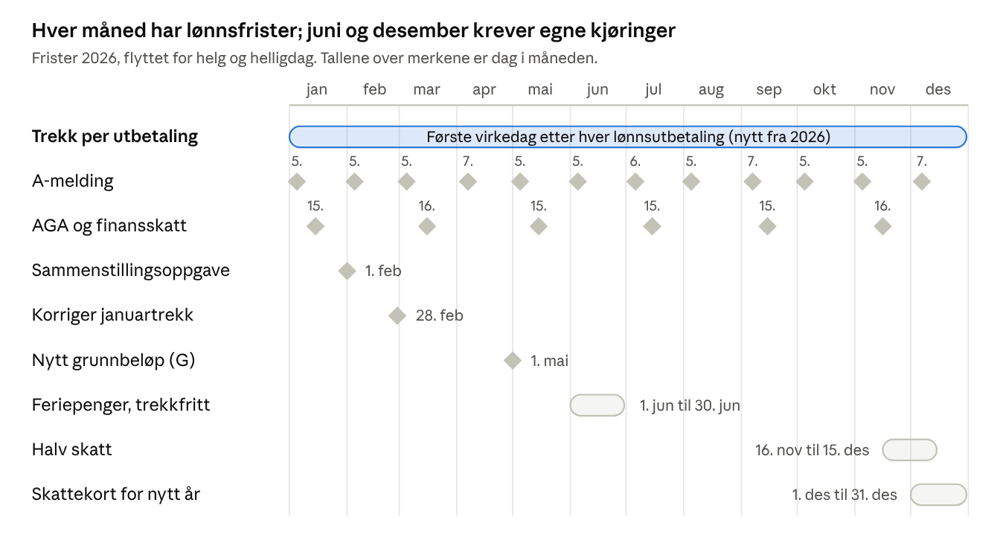

# Årshjul og frister

Lønnsåret har frister hver måned: trekk betales etter hver utbetaling, a-meldingen den 5., og AGA og finansskatt den 15. annenhver måned.

Halv skatt gjelder enten andre halvdel av november eller første halvdel av desember, valgt av arbeidsgiver. Feriepenger utbetales siste vanlige lønningsdag før ferien, i praksis i juni. A-meldingen for desember 2026 har frist 5.1.2027, og 6. termin AGA forfaller 15.1.2027. I tillegg kommer lønnskartlegging etter kjønn annethvert år og normrente som fastsettes for hver tomånedersperiode.
